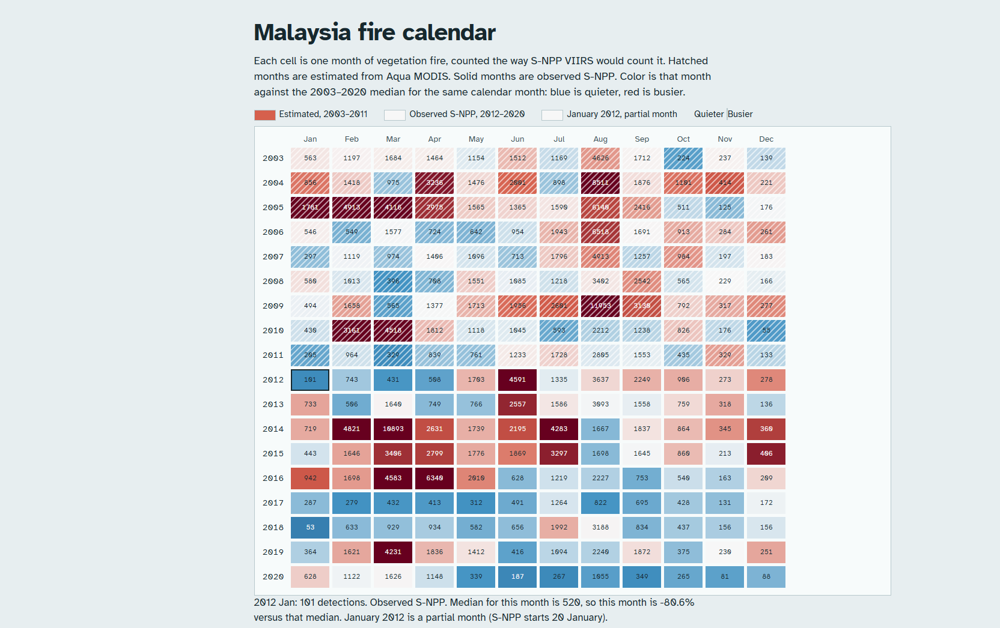
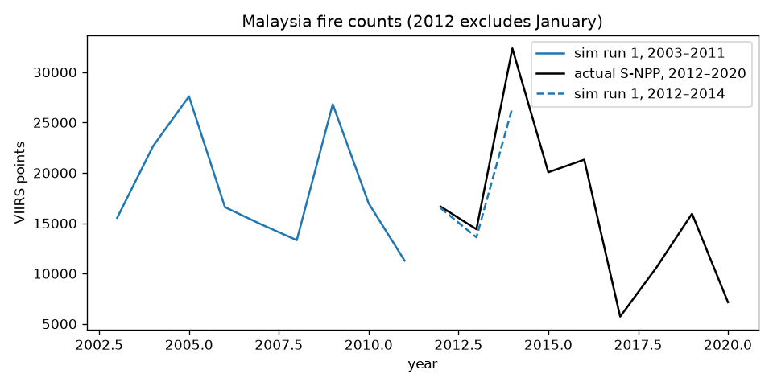
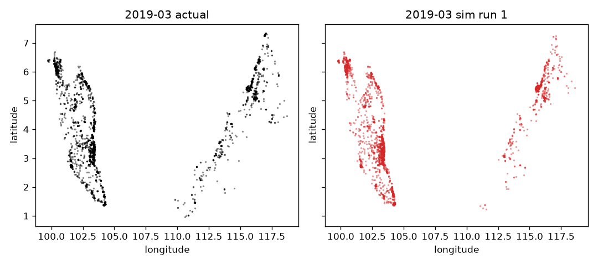
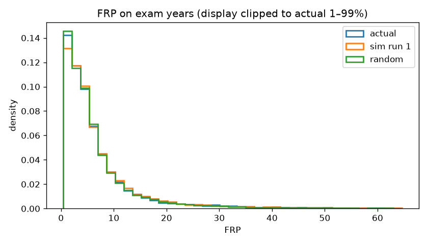

# Harmonizing MODIS and VIIRS Active-Fire Hotspots — Workflow, Theory and Accuracy

*NASA Space Apps Challenge 2026 · "Harmonization of MODIS and VIIRS Hot Spots" · Demonstration country: Malaysia*
*Version 1.0, 2026-11-15. All numbers recomputed from the delivered files.*

---

## At a glance: what the system does, and how much to trust it

**What it does.** Input: NASA FIRMS Aqua MODIS hotspots. Output: what Suomi-NPP VIIRS would have reported — monthly counts on a 0.25° grid, a 2003–2020 burning calendar, and a point-level file with the same 15 columns as a FIRMS VIIRS CSV.

**How it was tested.** Every number below comes from **leave-one-year-out** testing: the model is trained on eight of the nine years 2012–2020 and predicts the ninth, which it has never seen — the same situation as converting 2003–2011. The method was chosen by a rule fixed before the test, and every result is compared with a no-conversion baseline and simpler multipliers.

| Output | How accurate | Trust it for |
|---|---|---|
| National / regional **monthly totals** | ~17% monthly error (Malaysia, 9 held-out years; Indonesia 15%) vs ~85% without conversion | ✅ Comparing months and years, seasonality, anomalies |
| **Yearly totals** | Within ±10% in most years; **large fire years 15–24% too low** | ✅ Ranking years — but big years are conservative |
| **Peak fire month** | Correct in every exam year | ✅ Fire-season timing |
| Month **above/below normal** | Correct 78% of the time (vs 60% for a simple multiplier) | ✅ with care |
| Single **0.25° cells** | Error similar to simple methods (~0.8 detections per cell-month) | ⚠️ Not on its own — aggregate first |
| **Synthetic VIIRS points** | Placed far better than chance (cell correlation 0.83 vs 0.52); realistic FRP; other attributes typical of VIIRS | ⚠️ A simulation, not observations |

**Bottom line.** Reliable for the question the challenge asks — *when, and in which years, burning was high or low* — at national and regional monthly scale. Not a substitute for real detections at individual locations.

---

## 1. Problem

NASA has recorded active-fire hotspots from space since November 2000, but the record is split between two instruments:

| | MODIS (Terra, Aqua) | VIIRS (Suomi-NPP, NOAA-20, NOAA-21) |
|---|---|---|
| Record | Nov 2000 → present (Aqua from Jul 2002) | Jan 2012 → present (S-NPP ended 2 Nov 2026) |
| Pixel at nadir | ~1 km | 375 m |
| Pixel at scan edge | ~2.0 × 4.8 km | ~0.8 km |
| Sensitivity | Misses many small or cool fires | Detects much smaller fires |

Because VIIRS sees more and smaller fires, the raw hotspot count jumps when the record switches sensors. In Malaysia, 2012–2020, VIIRS reports **6.7 times** as many vegetation-fire detections as Aqua MODIS (144,253 vs 21,498 after cleaning). A burning calendar that simply joins the two records would show a fake six-fold "increase in fire" in 2012.

**Goal.** Put both sensors on one scale, so that "which months and years burn most" and "how this month compares with normal" can be answered fairly from the early 2000s to today.

**Reference scale.** We express everything as **S-NPP VIIRS-equivalent hotspots**: the number of detections S-NPP VIIRS would have reported. S-NPP has the longest VIIRS record (2012–2026) and crosses the equator at about the same local time as Aqua MODIS (~13:30 and ~01:30), which makes the two directly comparable.

---

## 2. Data

All data come from **NASA FIRMS** (the only resource listed for this challenge), using the **Standard Processing (science-quality)** country-year files:

```
https://firms.modaps.eosdis.nasa.gov/data/country/{modis|viirs-snpp|viirs-jpss1}/{YEAR}/{product}_{YEAR}_{Country}.csv
index: https://firms.modaps.eosdis.nasa.gov/data/country/yearly_summary_files.txt
```

| Product | Years used | Role |
|---|---|---|
| MODIS Collection 6.1, Aqua | 2003–2020 | Input (2012–2020 for training, 2003–2011 for the "normal fire" climate features and for the conversion) |
| VIIRS 375 m, Suomi-NPP | 2012–2020 | Answer during training and testing |

Each CSV row is one hot pixel: centre latitude/longitude, acquisition date and UTC time, pixel size along scan and track (`scan`, `track`, km), fire radiative power (`frp`, MW), brightness temperatures, confidence, day/night flag and a hotspot `type` (0 vegetation fire, 1 volcano, 2 static land source, 3 offshore).

**Cleaning (both sensors).**

1. Keep Aqua for MODIS and S-NPP for VIIRS only.
2. Keep `type = 0` (vegetation fires).
3. Harmonise confidence into three classes — MODIS `<30` low, `30–79` nominal, `≥80` high; VIIRS `l/n/h` — and keep nominal and high.
4. Remove duplicate detections of the same fire from overlapping scan lines ("bow-tie" effect): same satellite, same minute, and pixel footprints overlapping by more than 30%; keep the detection with the highest FRP. This rule follows Fu et al. (2020) and Zheng et al. (2026). It removed 6.7% of MODIS and 8.7% of VIIRS detections in Malaysia.

---

## 3. Theory: why the two sensors disagree, and how we correct it

1. **Pixel size and sub-pixel fires.** A fire is detected when it raises the mid-infrared signal of a pixel enough above its background. A small fire fills a larger share of a 375 m pixel than of a 1 km pixel, so VIIRS detects fires that MODIS cannot (Schroeder et al., 2014).
2. **One fire, several VIIRS pixels.** A fire that covers one MODIS pixel can cover several VIIRS pixels. Our pairing analysis (Section 5) shows that a MODIS detection seen by both sensors corresponds to about **2.3–2.8 VIIRS detections**.
3. **Fires MODIS misses entirely.** In Malaysia, **38.5%** of all VIIRS detections fall in grid cell-months where MODIS saw nothing. These cannot be recovered by multiplying MODIS counts, which is why a simple multiplier under-counts.
4. **Viewing angle.** MODIS pixels grow up to ~10× in area towards the scan edge, and MODIS misses more fires there (Li et al., 2020). FIRMS gives the pixel size (`scan × track`), which we use as a viewing-angle feature.
5. **Day and night.** VIIRS is relatively more sensitive at night. The VIIRS/MODIS ratio is about 6 by day and about 24 by night (Indonesia test), so day and night are always treated separately.

**Correction approach.** Start from a physically simple multiplier (ratio of totals), then let a machine-learning model correct what the multiplier cannot capture: fire intensity, pixel size, neighbouring activity, and fires MODIS missed.

---

## 4. Workflow and functions

### 4.1 Gridding — `build_features.py`
Every detection is placed in a **0.25° grid cell** (`cell centre = floor(lat / 0.25) · 0.25 + 0.125`, the same for longitude). One table row = **one cell × one year × one month × day or night**. Every cell that ever burned gets a row for every month, filled with zeros where nothing was detected, so the model also learns "no fire".

MODIS-derived features for each row (no VIIRS information is ever used as input):

| Feature | Meaning |
|---|---|
| `m_count` | MODIS detections |
| `m_frp_mean`, `m_frp_max` | Fire intensity |
| `pixel_area` = mean `scan × track` | Viewing angle |
| `m_frac_high`, `m_frac_nominal` | Confidence mix |
| `m_count_other_dn` | MODIS detections in the same cell and month at the other time of day |
| `nb_adj` | MODIS detections in the eight neighbouring cells |
| `m_clim_mean`, `m_clim_frp` | The cell's "normal" MODIS fire for that month, from 2003–2011 only |
| `lat`, `lon`, `month_sin`, `month_cos`, `is_night` | Place, season, time of day |

The answer (target) is `v_count`, the S-NPP detections in the same row. **Year and cell ID are never features**, and an automatic check rejects any feature whose name refers to VIIRS.

### 4.2 Baseline multipliers

- **Day/night k** (`daynight_k`): `k = ΣVIIRS ÷ ΣMODIS` over training rows where MODIS > 0, separately for day and night. Prediction = `m_count × k`.
- **Stratified k** (`strat_k`): the same ratio per 1° region × calendar month × day/night, smoothed towards the national value when data are sparse:
  `k* = (ΣV + 50 · k_parent) / (ΣM + 50)`

### 4.3 Fusion model — `loyo.py` (`fit_fusion`, `fusion_G1`)

1. **Base** = `m_count × k_daynight`.
2. A **random forest** (`sklearn.ensemble.RandomForestRegressor`: 200 trees, `max_features = 0.33`, `min_samples_leaf = 20`, `max_depth = 24`, sample weight `max(m_count, 1)`) learns the **residual** `VIIRS − base` from the features above.
3. **Prediction** = `max(base + residual, 0)`. A cell with MODIS = 0 can therefore receive fires that MODIS missed.
4. **G1 rule (chosen version)**: a cell with MODIS = 0 only receives fires if there is MODIS fire **next to it** (`nb_adj > 0`) or **at the other time of day** (`m_count_other_dn > 0`); isolated empty cells stay at 0. Without this rule the model spreads a "background" of small fires every year, which over-predicts quiet years (+57% in 2017) and flattens the difference between fire years and quiet years.

### 4.4 Testing protocol: leave one year out
The real use is to apply the model to **years it has never seen** (2003–2011). We therefore test exactly that:

- For each year 2012–2020, train on the other eight years and predict the held-out year, for every cell.
- **Main metric:** national monthly WAPE = `Σ|predicted − actual| ÷ Σactual`, summed over day and night, for each month of the held-out year.
- Method choice was fixed in advance: lowest mean WAPE on the **exam years** 2012 (January excluded), 2019 and 2020, with the year-to-year variability ratio as the tie-breaker. 2013–2018 were used for tuning.
- **January 2012 is never scored**, because S-NPP data start on 20 January 2012.

---

## 5. Accuracy (Malaysia, 2012–2020, leave one year out)

**Monthly national error (WAPE, %) for each held-out year:**

| Method | 2012* | 2013 | 2014 | 2015 | 2016 | 2017 | 2018 | 2019 | 2020 | Exam-year mean | **9-year mean** |
|---|---|---|---|---|---|---|---|---|---|---|---|
| No conversion (raw MODIS) | 80.6 | 82.3 | 86.7 | 85.1 | 86.4 | 81.6 | 85.7 | 87.4 | 87.1 | 85.1 | 84.8 |
| Day/night k | 22.9 | 32.5 | 44.6 | 38.8 | 42.3 | 30.7 | 43.4 | 44.1 | 46.4 | 37.8 | 38.4 |
| Stratified k | 29.8 | 8.0 | 15.6 | 17.6 | 7.0 | 12.6 | 17.1 | 14.2 | 23.6 | 22.5 | 16.2 |
| Fusion (original) | 16.0 | 16.7 | 19.7 | 11.6 | 14.3 | 57.4 | 16.9 | 10.9 | 39.8 | 22.2 | 22.6 |
| **Fusion G1 (chosen)** | **10.6** | 13.8 | 23.9 | 16.7 | 18.2 | 17.9 | 16.8 | **18.3** | **17.5** | **15.5** | **17.1** |

*2012 without January.

**Other measures on the exam years (Fusion G1 vs day/night k):**

| Measure | Fusion G1 | Day/night k |
|---|---|---|
| Error in the yearly total | 9.1% | 37.8% |
| Correlation of monthly totals | 0.981 | 0.973 |
| Peak fire month correct | 100% | 100% |
| Month above/below normal correctly called | 77.5% | 60.1% |
| Year-to-year variability ratio (1 = ideal) | 0.99 | 0.85 |

**How to read this.**

- Converting reduces the monthly error from **~85%** (raw MODIS) to **~17%** (Fusion G1, any held-out year) — about a five-fold improvement.
- Stratified k has a similar 9-year mean (16.2%), but it **exaggerates** the difference between fire years and quiet years (variability ratio 1.41), and its worst year is 29.8%. Fusion G1 keeps the year-to-year pattern (0.99) and never exceeds 24%. Because the burning calendar is used to compare years, we chose Fusion G1.
- The target of ≤15% monthly error was **not quite reached** (15.5% on the exam years, 17.1% over all nine years).
- At the level of single 0.25° cells, no method is accurate (cell-level MAE ≈ 0.83 detections per cell-month for every method). The results are reliable for **regional and national monthly totals**, not for individual cells.

**Does it hold in another country? (Indonesia, same code, 200 trees)**

| Method | Exam-year mean (2012*, 2019, 2020) | 9-year mean |
|---|---|---|
| No conversion | 86.9% | 86.4% |
| Day/night k | 29.1% | 23.7% |
| Stratified k | 29.0% | 16.8% |
| Fusion (original) | 32.1% | 20.4% |
| **Fusion G1** | 27.4% | **15.3%** |

The same pre-registered rule selects Fusion G1 again, and its nine-year error (15.3%) is close to Malaysia's (17.1%). The exam-year mean is dominated by 2012 (53.5%), the first and least stable year of the S-NPP record; 2019 and 2020 score 7.3% and 21.4%. Indonesia has no 2003–2011 Aqua data in our download, so its "normal fire" features use the other overlap years instead.

**Model size.** Re-running Malaysia's Fusion G1 with 800 trees gives 15.46% (exam years) and 17.00% (nine years), the same as 200 trees, so the delivered results use 200 trees.

*Post-hoc note (not adopted):* averaging Fusion G1 and Stratified k gives a 14.4% nine-year mean but 17.6% on the exam years. Because this was found after seeing the results, the pre-registered choice was kept.

**Pairing evidence (Indonesia 2023, Section 3 point 2).** Matching each MODIS detection with S-NPP detections inside its pixel footprint within 5 minutes: 7.9% of MODIS detections have a match, each with **2.3** VIIRS detections on average; a time-shifted control matches only 1.3%, so the excess of genuine co-observations is 6.6 percentage points. In Malaysia 2012–2020, footprint matching within the same overpass (|Δt| ≤ 90 min) produced 24,601 MODIS–VIIRS links (Section 6).

---

## 6. Point-level synthetic VIIRS (`sim_viirs.py`)

**Goal.** Turn a MODIS record into a file that looks exactly like a FIRMS S-NPP VIIRS CSV — same 15 columns (`latitude, longitude, bright_ti4, scan, track, acq_date, acq_time, satellite, instrument, confidence, version, bright_ti5, frp, daynight, type`) — plus four columns that mark it as synthetic: `is_synthetic`, `sim_source` (`paired` or `hole`), `sim_parent_modis`, `sim_run`; `version = SIM1.0`.

**Method.**

1. **Training pairs (2012–2020).** Each Aqua detection is matched with the S-NPP detections whose centres fall inside its pixel footprint (`|Δx| ≤ (scan_M + scan_V)/2` east–west, `|Δy| ≤ (track_M + track_V)/2` north–south) during the same overpass (|Δt| ≤ 90 min). This gave 24,601 links; 86% of VIIRS detections had no MODIS partner, which is why counts cannot come from pairing alone.
2. **How many.** For every cell × month × day/night, the number of synthetic detections is drawn from a Poisson distribution whose mean is the Fusion G1 prediction. The national totals therefore follow Fusion G1 (difference < 1%).
3. **What they look like (analogue resampling).** Each MODIS detection is matched to its K = 5 most similar MODIS detections in the training years (standardised FRP, brightness, pixel size, confidence, day/night, season, location), and the VIIRS detections that accompanied one of them are copied over: offset from the MODIS centre, FRP, brightness temperatures, pixel size, confidence and time difference. Extra detections needed to reach the cell's count are drawn from the unmatched VIIRS detections seen in the same cell and month in training years, jittered by up to ±375 m.
4. **Five runs** with different random seeds show the spread.

**Tested on held-out years** (2012 without January, 2019, 2020; tuned on 2013–2018), against a control that draws the same number of real VIIRS detections from the same month of the training years:

| Measure | Synthetic | Control |
|---|---|---|
| Monthly national WAPE (mean of 15 runs) | 15.45% | — (equal to the true count by construction) |
| Cell-level (0.25°) MAE / correlation | **1.55 / 0.83** | 2.22 / 0.52 |
| Same-day, within 1 km: precision (paired / hole) | **0.65** / 0.030 | 0.007 |
| FRP distribution distance (Wasserstein) | **0.87** | 1.34 |
| Brightness, pixel size, confidence distributions | similar | similar (control slightly better) |

**Interpretation.** Synthetic detections are placed much better than chance and reproduce realistic FRP; brightness temperature, pixel size and confidence values are realistic but carry no more information than "a typical VIIRS detection in that month". Individual synthetic points must not be read as observed fires.

## 7. Converted record 2003–2011

Using all of 2012–2020 for training, the Aqua MODIS record of 2003–2011 was converted into S-NPP-equivalent detections (Fusion G1 for the counts, Section 6 for the points). One synthetic VIIRS CSV per year: `results/synthetic_viirs/viirs-sim_{year}_Malaysia.csv`.

| Year | 2003 | 2004 | 2005 | 2006 | 2007 | 2008 | 2009 | 2010 | 2011 |
|---|---|---|---|---|---|---|---|---|---|
| S-NPP-equivalent detections (mean of 5 runs) | 15,725 | 22,994 | 27,637 | 16,502 | 14,853 | 13,398 | 26,759 | 17,137 | 11,297 |

The full range across the five runs is at most 2.2% of the mean in any year. The "normal fire" features for a converted year are computed from 2003–2011 **excluding that year**, so the conversion never uses the year it is converting. Night detections are 22.6% of the converted record versus 32.5% in the real 2012–2020 S-NPP record, because Aqua itself saw fewer night fires in 2003–2011 (5.3% of its detections) than in 2012–2020 (9.5%).

**Continuity at the 2011/2012 switch.** Out-of-sample yearly totals (each year predicted by a model that never saw it), Fusion G1 vs actual S-NPP:

| Year | 2012* | 2013 | 2014 | 2015 | 2016 | 2017 | 2018 | 2019 | 2020 |
|---|---|---|---|---|---|---|---|---|---|
| Difference in yearly total | +2.0% | −4.0% | −24.0% | −15.0% | −17.0% | +10.0% | −16.0% | −18.0% | −7.0% |

*2012 without January. There is no step at the switch, but **large fire years are under-estimated by about 15–24%** and the quietest year slightly over-estimated, so converted fire years before 2012 (e.g. 2005, 2009) are probably somewhat larger than shown.

---

## 8. Limitations

- **Two-country validation.** Accuracy is measured for Malaysia (main) and Indonesia (check); other countries need their own validation.
- **Calendar starts in 2003.** November 2000 – June 2002 has only Terra MODIS, which needs its own bridge to S-NPP and is not converted in this version.
- **No interactive area or date selection yet.** The demonstration page shows a national calendar for Malaysia with downloads; selecting an arbitrary region is future work.
- **Cells vs regions.** Reliable for monthly regional/national totals; single 0.25° cells are not.
- **Missed fires are estimated.** 38.5% of VIIRS detections are where MODIS saw nothing; their number is modelled, and their locations in the synthetic data come from where S-NPP saw fire in 2012–2020 (assuming fire-prone places did not change).
- **Pixel shape** is approximated as an east–west × north–south rectangle from `scan` and `track` (FIRMS gives no corners). NASA's own FIRMS footprint files use the same approximation.
- **Time precision** in FIRMS is one minute, so the duplicate rule is approximate.
- **Orbit drift.** Aqua and Terra orbits drift after ~2021, so training stops at 2020.
- **S-NPP ended on 2 Nov 2026.** Recent months need NOAA-20/NOAA-21 and a separate bridge (not yet built).
- **Large fire years** are under-estimated by about 15–24% out of sample (Section 7).

---

## Figures


*Malaysia burning calendar. Hatched = estimated from Aqua MODIS (2003–2011); solid = observed S-NPP (2012–2020). Colour = month vs the 2003–2020 median for that calendar month.*


*Yearly S-NPP-equivalent detections: converted 2003–2011, observed 2012–2020, and the converted series for 2012–2014 (dashed).*


*Held-out month: real S-NPP detections (left) and one synthetic run (right).*


*FRP distribution on the exam years: real, synthetic, and the random-draw control.*

## 9. References

1. NASA FIRMS. https://www.earthdata.nasa.gov/data/tools/firms · FAQ and attribute tables · Archive download https://firms.modaps.eosdis.nasa.gov/download/
2. Schroeder, W. et al. (2014). The New VIIRS 375 m active fire detection data product. *Remote Sensing of Environment* 143:85–96. https://doi.org/10.1016/j.rse.2013.12.008
3. Li, F., Zhang, X., Kondragunta, S. (2020). Biomass burning in Africa: FRP missed by MODIS using the 375 m VIIRS product. *Remote Sensing* 12(10):1561. https://doi.org/10.3390/rs12101561
4. Fu, Y. et al. (2020). Fire detection and FRP in Northeast Asia: MODIS versus VIIRS. *Remote Sensing* 12(18):2870. https://doi.org/10.3390/rs12182870
5. Zheng, Y. et al. (2026). FRP correction and spatiotemporal fusion based on MYD14 and VNP14IMG. *Remote Sensing* 18(10):1650. https://doi.org/10.3390/rs18101650
6. Breiman, L. (2001). Random Forests. *Machine Learning* 45:5–32.
7. Roberts, D.R. et al. (2017). Cross-validation strategies for data with temporal, spatial, hierarchical, or phylogenetic structure. *Ecography* 40:913–929.
8. scikit-learn 1.9 — RandomForestRegressor, RandomForestClassifier. https://scikit-learn.org

*AI use: analysis code and documentation were developed with AI assistants (Claude, Cursor agents) under human direction; all numbers were recomputed from the data.*
