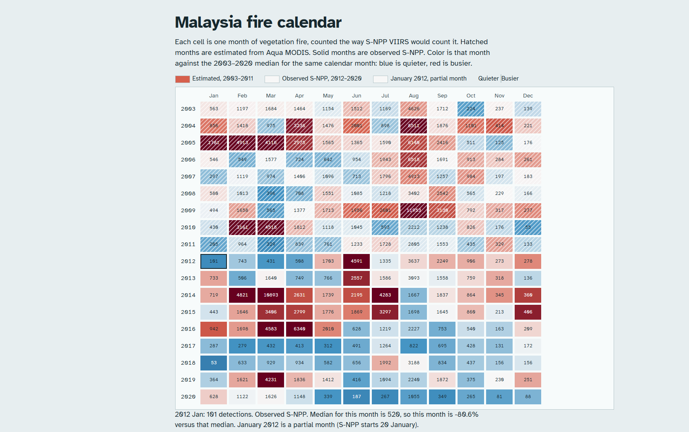
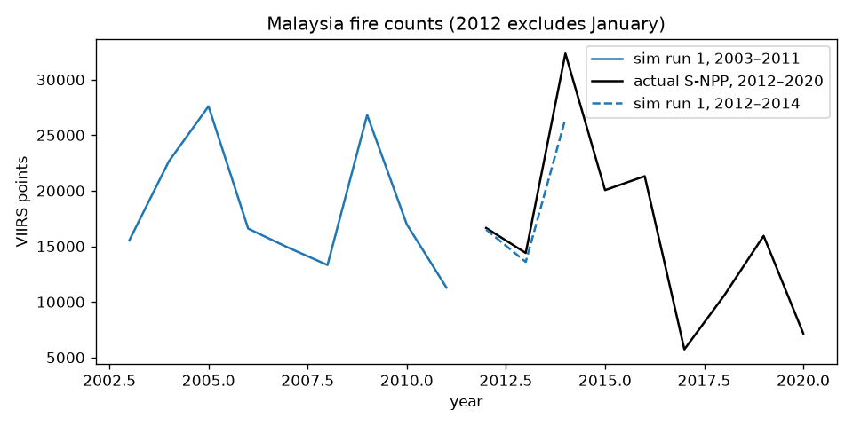
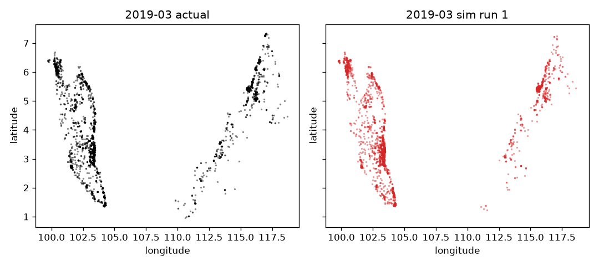
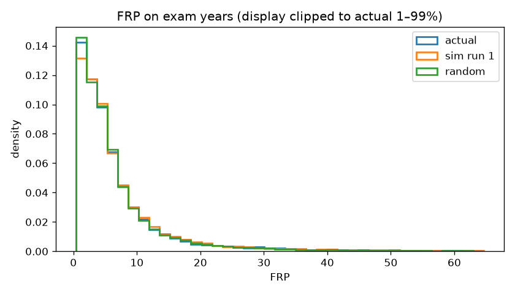

# MODIS → VIIRS 火点协调系统：怎么运作、准不准、可不可信

*NASA Space Apps 2026 ·「Harmonization of MODIS and VIIRS Hot Spots」· 示范国家：马来西亚（另用印尼验证）*
*版本 1.0，2026-11-15。所有数字都由交付的文件重新算过。*

---

## 一页看懂：这个系统做什么、能信到什么程度

**做什么**：输入 NASA FIRMS 的 **Aqua MODIS** 火点，输出 **Suomi-NPP VIIRS 当时会看到什么**，包括：

- 0.25° 格子 × 每月的火点数
- 2003–2020 年的燃烧日历
- 一份和 FIRMS VIIRS CSV **一样 15 栏**的逐点模拟资料

**怎么测**：全部用"**藏一整年**"来考。用 2012–2020 年中的 8 年训练，去猜**从没看过**的第 9 年，轮流 9 次。这和"拿去换算 2003–2011 年"是同一种情况。用哪个方法是考试前就定好的规则，每个结果都和"不换算"、"简单倍数"放在一起比较。

| 输出 | 准度 | 可以拿来做什么 |
|---|---|---|
| 全国 / 区域的**每月总数** | 每月误差约 **17%**（马来西亚 9 年平均；印尼 15%）；不换算是约 **85%** | ✅ 比较月份、年份、火季、异常 |
| **每年总数** | 大部分年份在 ±10% 内；**大火年低估 15–24%** | ✅ 排名年份，但大火年的数字偏保守 |
| **火最多的月份** | 考试年全部猜对 | ✅ 火季时间 |
| 某月**比平常多还是少** | 78% 判断正确（简单倍数是 60%） | ✅ 小心使用 |
| 单一 **0.25° 格子** | 误差和简单方法差不多（每格每月约 0.8 个点） | ⚠️ 不要单独看，先加总成区域 |
| **逐点模拟 VIIRS** | 位置比随便抽样好很多（格子相关 0.83 vs 0.52）；FRP 很像真的；其他栏位只是"像一般的 VIIRS 点" | ⚠️ 是模拟，不是观测 |

**结论**：对比赛问的问题——"**哪些月份、哪些年份火多或火少**"——在全国和区域的月度层级是可信的。但它不能取代某一个地点的真实观测。

---

## 1. 问题

NASA 从 2000 年 11 月开始用卫星记录火点，但记录分在两种仪器上：

| | MODIS（Terra、Aqua） | VIIRS（S-NPP、NOAA-20、NOAA-21） |
|---|---|---|
| 年份 | 2000-11 至今（Aqua 从 2002-07） | 2012-01 至今（S-NPP 2026-11-02 停止） |
| 正下方像素 | 约 1 km | 375 m |
| 扫描边缘像素 | 约 2.0 × 4.8 km | 约 0.8 km |
| 灵敏度 | 很多小火、温度低的火看不到 | 看得到小很多的火 |

VIIRS 看得比较细，所以换卫星时火点数会突然跳高。马来西亚 2012–2020 年，VIIRS 的植被火点数是 Aqua MODIS 的 **6.7 倍**（清理后 144,253 vs 21,498）。直接把两段接起来，日历会在 2012 年出现一个假的"火灾暴增 6 倍"。

**目标**：把两种卫星换算成同一把尺子，让 2000 年代初到现在可以公平比较。

**标准尺**：全部换算成"**S-NPP VIIRS 会看到的火点数**"。S-NPP 的 VIIRS 记录最长（2012–2026），而且和 Aqua 几乎同时经过赤道（当地约 13:30 和 01:30），最适合拿来比较。

---

## 2. 数据

全部来自 **NASA FIRMS**（比赛唯一列出的资料来源）的**标准处理版**（科学品质）国家年度 CSV：

```
https://firms.modaps.eosdis.nasa.gov/data/country/{modis|viirs-snpp}/{年份}/{产品}_{年份}_{国家}.csv
```

| 产品 | 用到的年份 | 角色 |
|---|---|---|
| MODIS C6.1，Aqua | 2003–2020 | 输入（2012–2020 训练；2003–2011 算"平常的火"、做换算） |
| VIIRS 375 m，S-NPP | 2012–2020 | 训练和考试时的答案 |

**清理（两种卫星都做）**：

1. MODIS 只留 Aqua，VIIRS 只留 S-NPP
2. 只留 `type = 0`（植被火），去掉火山、工厂、海上
3. 置信度统一成三档（MODIS：<30 低、30–79 中、≥80 高；VIIRS：l/n/h），只留中和高
4. **去掉重复点**：同一颗卫星、同一分钟、像素面积重叠 > 30% → 只留火力（FRP）最大的那个。规则来自文献 [4][5]。马来西亚去掉了 MODIS 6.7%、VIIRS 8.7%

---

## 3. 理论：两颗卫星为什么不一样、怎么修正

1. **像素大小**：火要让整个像素的中红外讯号明显变高才会被侦测。同一个小火，在 375 m 像素里占的比例比在 1 km 像素里大，所以 VIIRS 看得到、MODIS 看不到（文献 [2]）。
2. **一场火、好几个 VIIRS 点**：盖住一个 MODIS 像素的火，可能盖住好几个 VIIRS 像素。配对分析显示，两边都看到的火，**一个 MODIS 点约对应 2.3–2.8 个 VIIRS 点**。
3. **MODIS 完全没看到的火**：马来西亚有 **38.5%** 的 VIIRS 点，落在 MODIS 什么都没看到的格子和月份里。光把 MODIS 乘上一个倍数补不回来，所以简单倍数会低估。
4. **视角**：MODIS 像素越靠近扫描边缘，面积大到约 10 倍，漏看也越多（文献 [3]）。FIRMS 有提供像素大小（`scan × track`），我们拿来当"视角"特征。
5. **白天和晚上**：VIIRS 在晚上相对灵敏很多。VIIRS ÷ MODIS 白天约 6 倍、晚上约 24 倍（印尼测试），所以白天和晚上一律分开处理。

**修正思路**：先用一个物理上简单的倍数（总数相除）当基础，再用机器学习修正倍数照顾不到的部分：火的强度、像素大小、附近的火，以及 MODIS 漏看的火。

---

## 4. 流程和函数

### 4.1 网格化（`build_features.py`）
每个火点放进 **0.25° 格子**（中心 = `floor(纬度 / 0.25) × 0.25 + 0.125`，经度同样）。**一行 = 一个格子 × 一年 × 一个月 × 白天或晚上**。曾经有火的格子，每个月都有一行，没火就填 0，让模型也学到"没有火"。

每一行的 MODIS 特征（**输入完全不用 VIIRS 的资料**）：

| 特征 | 意思 |
|---|---|
| `m_count` | MODIS 火点数 |
| `m_frp_mean`、`m_frp_max` | 火的强度 |
| `pixel_area` = 平均 `scan × track` | 视角 |
| `m_frac_high`、`m_frac_nominal` | 置信度比例 |
| `m_count_other_dn` | 同一格子同一月"另一个时段"（白天对晚上）的 MODIS 点数 |
| `nb_adj` | 周围 8 个格子的 MODIS 点数 |
| `m_clim_mean`、`m_clim_frp` | 这个格子这个月份"平常"的 MODIS 火，只用 2003–2011 年算 |
| `lat`、`lon`、`month_sin`、`month_cos`、`is_night` | 位置、季节、白天晚上 |

答案是 `v_count`（同一行的 S-NPP 点数）。**年份和格子编号绝对不当特征**，程序会自动检查，任何和 VIIRS 有关的特征名称都会被拒绝。

### 4.2 基础倍数

- **白天/晚上倍数**（`daynight_k`）：训练资料中 MODIS > 0 的行，`k = ΣVIIRS ÷ ΣMODIS`，白天晚上分开算。预测 = `m_count × k`
- **分层倍数**（`strat_k`）：每个 1° 区域 × 月份 × 白天晚上各算一个，资料少就向全国借：
  `k* = (ΣV + 50 × k_上一层) / (ΣM + 50)`

### 4.3 融合模型（`loyo.py` 的 `fit_fusion`、`fusion_G1`）

1. **基础值** = `m_count × 白天/晚上倍数`
2. **随机森林**（`sklearn.ensemble.RandomForestRegressor`：200 棵树、`max_features = 0.33`、`min_samples_leaf = 20`、`max_depth = 24`，样本权重 `max(m_count, 1)`）学习"**真实 VIIRS − 基础值**"的差距
3. **预测** = `max(基础值 + 差距, 0)`。MODIS 为 0 的格子也可以被补上 MODIS 漏看的火
4. **G1 规则（最后选定的版本）**：MODIS 为 0 的格子，只有在**旁边格子有火**（`nb_adj > 0`）或**另一个时段有火**（`m_count_other_dn > 0`）时才补值；完全孤立的空格子维持 0。没有这条规则时，模型每年都会补上差不多的"背景小火"，导致火少的年份被高估（2017 年 +57%），也会把大火年和平静年的差别压平

### 4.4 考试方式：藏一整年
实际用途是拿模型去换算**它从没看过的年份**（2003–2011），所以考试也照这个方式：

- 2012–2020 每一年轮流藏起来，用另外 8 年训练，预测被藏的那一年的每个格子
- **主要指标**：全国每月 WAPE = `Σ|预测 − 真实| ÷ Σ真实`（白天晚上加总），算被藏那一年的每个月
- **选方法的规则事先写死**：考试年（2012 不含 1 月、2019、2020）的平均 WAPE 最低者胜；同分时看"年际变化比"最接近 1 的。2013–2018 年用来调参数
- **2012 年 1 月永远不计分**：S-NPP 的资料从 2012-01-20 才开始

---

## 5. 准度（马来西亚，2012–2020，藏一整年）

**每个被藏年份的全国每月误差（WAPE，%）**：

| 方法 | 2012* | 2013 | 2014 | 2015 | 2016 | 2017 | 2018 | 2019 | 2020 | 考试年平均 | **9 年平均** |
|---|---|---|---|---|---|---|---|---|---|---|---|
| 不换算（原始 MODIS） | 80.6 | 82.3 | 86.7 | 85.1 | 86.4 | 81.6 | 85.7 | 87.4 | 87.1 | 85.1 | 84.8 |
| 白天/晚上倍数 | 22.9 | 32.5 | 44.6 | 38.8 | 42.3 | 30.7 | 43.4 | 44.1 | 46.4 | 37.8 | 38.4 |
| 分层倍数 | 29.8 | 8.0 | 15.6 | 17.6 | 7.0 | 12.6 | 17.1 | 14.2 | 23.6 | 22.5 | 16.2 |
| 融合（原版） | 16.0 | 16.7 | 19.7 | 11.6 | 14.3 | 57.4 | 16.9 | 10.9 | 39.8 | 22.2 | 22.6 |
| **融合 G1（选定）** | **10.6** | 13.8 | 23.9 | 16.7 | 18.2 | 17.9 | 16.8 | **18.3** | **17.5** | **15.5** | **17.1** |

\*2012 年不含 1 月。

**考试年的其他指标（融合 G1 vs 白天/晚上倍数）**：

| 指标 | 融合 G1 | 白天/晚上倍数 |
|---|---|---|
| 每年总数误差 | 9.1% | 37.8% |
| 每月总数的相关系数 | 0.981 | 0.973 |
| 火最多的月份猜对 | 100% | 100% |
| 某月比平常多或少判断正确 | 77.5% | 60.1% |
| 年际变化比（1 最理想） | 0.99 | 0.85 |

**怎么解读**：

- 换算后，每月误差从约 **85%**（原始 MODIS）降到约 **17%**（融合 G1，任何一个没看过的年份），**改善约 5 倍**
- 分层倍数的 9 年平均差不多（16.2%），但它会**夸大**大火年和平静年的差别（年际变化比 1.41），最差的一年 29.8%。融合 G1 保留了年与年之间的样子（0.99），最差也不超过 24%。燃烧日历是拿来比较年份的，所以选融合 G1
- 目标"每月误差 ≤ 15%"**差一点没达到**（考试年 15.5%，9 年 17.1%）
- 单一 0.25° 格子的层级，没有任何方法是准的（每个方法每格每月误差约 0.83 个点）。结果可信的是**区域和全国的月度总数**，不是单一格子

**换一个国家也成立吗？（印尼，同一套程序，200 棵树）**

| 方法 | 考试年平均 | 9 年平均 |
|---|---|---|
| 不换算 | 86.9% | 86.4% |
| 白天/晚上倍数 | 29.1% | 23.7% |
| 分层倍数 | 29.0% | 16.8% |
| 融合（原版） | 32.1% | 20.4% |
| **融合 G1** | 27.4% | **15.3%** |

同样的规则再次选出融合 G1，9 年误差（15.3%）和马来西亚（17.1%）接近。考试年平均被 2012 年拉高（53.5%）：那是 S-NPP 记录的第一年，也是最不稳定的一年；2019、2020 年分别是 7.3%、21.4%。

**模型大小**：马来西亚融合 G1 用 800 棵树重跑，考试年 15.46%、9 年 17.00%，和 200 棵一样，所以交付的结果用 200 棵。

*事后观察（不采用）*：把融合 G1 和分层倍数取平均，9 年平均 14.4%，但考试年是 17.6%。因为是看过结果才想到的，按事先写好的规则不改选。

---

## 6. 逐点模拟 VIIRS（`sim_viirs.py`）

**目标**：把 MODIS 的记录变成一份**和 FIRMS S-NPP VIIRS CSV 一模一样**的文件，15 栏都一样（`latitude, longitude, bright_ti4, scan, track, acq_date, acq_time, satellite, instrument, confidence, version, bright_ti5, frp, daynight, type`），另外加 4 栏标示是模拟的：`is_synthetic`、`sim_source`（`paired` 或 `hole`）、`sim_parent_modis`、`sim_run`；`version = SIM1.0`。

**方法**：

1. **训练配对（2012–2020）**：每个 Aqua 火点，配上落在它像素范围内（东西向 `|Δx| ≤ (scan_M + scan_V)/2`、南北向 `|Δy| ≤ (track_M + track_V)/2`）、同一次过境（|Δt| ≤ 90 分钟）的 S-NPP 火点。共得到 24,601 条配对；86% 的 VIIRS 点没有 MODIS 伙伴，这也是为什么数量不能只靠配对来决定
2. **有几个**：每个格子 × 月 × 白天晚上，用 Poisson 分布抽出模拟点数，平均值 = 融合 G1 的预测。所以全国总数跟着融合 G1（差距 < 1%）
3. **长什么样（类比抽样）**：每个 MODIS 点，在训练年份里找 5 个最像的 MODIS 点（标准化后的 FRP、亮温、像素大小、置信度、白天晚上、季节、位置），随机挑一个，把它当时配到的 VIIRS 点复制过来：相对位置、FRP、亮温、像素大小、置信度、时间差。数量不够的部分，从训练年份同一格子、同一月份没配到的 VIIRS 点抽，位置随机偏移最多 ±375 m
4. **跑 5 次**（不同的随机种子），看结果的范围

**用没看过的年份考试**（2012 不含 1 月、2019、2020；用 2013–2018 调参），对照组是"从训练年份同一个月的真实 VIIRS 里随机抽相同数量"：

| 指标 | 模拟 | 对照 |
|---|---|---|
| 全国每月 WAPE（15 次平均） | 15.45% | —（数量按设计就等于真实值） |
| 0.25° 格子的 MAE / 相关 | **1.55 / 0.83** | 2.22 / 0.52 |
| 同一天、1 km 内有真实火点（配对 / 补洞） | **0.65** / 0.030 | 0.007 |
| FRP 分布差距（Wasserstein） | **0.87** | 1.34 |
| 亮温、像素大小、置信度的分布 | 差不多 | 差不多（对照略好） |

**解读**：模拟点的位置比随便放好很多，FRP 也很像真的；亮温、像素大小、置信度的值看起来真实，但没有比"那个月份一般的 VIIRS 点"提供更多资讯。**单一模拟点不能当成真的观测到的火**。

---

## 7. 2003–2011 年的换算结果

用全部 2012–2020 年训练，把 2003–2011 年的 Aqua MODIS 换算成 S-NPP 的尺子。每年一个模拟 VIIRS CSV：`viirs-sim_{年份}_Malaysia.csv`。

| 年份 | 2003 | 2004 | 2005 | 2006 | 2007 | 2008 | 2009 | 2010 | 2011 |
|---|---|---|---|---|---|---|---|---|---|
| S-NPP 等效火点数（5 次平均） | 15,725 | 22,994 | 27,637 | 16,502 | 14,853 | 13,398 | 26,759 | 17,137 | 11,297 |

5 次模拟之间的差距，每年都不超过平均值的 2.2%。换算某一年时，"平常的火"特征用 2003–2011 年**扣掉那一年**来算，所以换算绝对不会用到正在换算的那一年。换算结果里晚上的火占 22.6%，真实 2012–2020 年是 32.5%，原因是 Aqua 自己在 2003–2011 年看到的晚上火就比较少（5.3%，2012–2020 年是 9.5%）。

**2011/2012 交接处**：用"藏一整年"的预测（每年都是没看过的）和真实 S-NPP 比每年总数：

| 年份 | 2012* | 2013 | 2014 | 2015 | 2016 | 2017 | 2018 | 2019 | 2020 |
|---|---|---|---|---|---|---|---|---|---|
| 每年总数差距 | +2.0% | −4.0% | −24.0% | −15.0% | −17.0% | +10.0% | −16.0% | −18.0% | −7.0% |

交接处没有断层，但**大火年会被低估约 15–24%**，最平静的年份略为高估。所以 2012 年以前的大火年（例如 2005、2009 年），实际上可能比显示的更大。

---

## 8. 限制

- **只验证了两个国家**：马来西亚（主要）和印尼（检查）。其他国家要另外验证
- **区域可信、格子不可信**：区域和全国的月度总数可信，单一 0.25° 格子不可信
- **漏看的火是估计的**：38.5% 的 VIIRS 点在 MODIS 什么都没看到的地方；它们的数量是模型估计的，模拟资料里的位置来自 2012–2020 年 S-NPP 在同一格子、同一月份看到火的地方（假设容易起火的地方没有改变）
- **日历从 2003 年开始**：2000-11 到 2002-06 只有 Terra MODIS，要另外建一座换算的桥，这一版没有做
- **像素形状**是用 `scan` 和 `track` 近似成东西 × 南北的长方形（FIRMS 没有给四个角）。NASA 自己的 FIRMS 像素范围文件也是这样画的
- **时间精度**：FIRMS 只到分钟，所以去重规则是近似的
- **轨道漂移**：Aqua 和 Terra 约 2021 年后轨道漂移，所以训练只用到 2020 年
- **S-NPP 已在 2026-11-02 停止**：最近的月份要用 NOAA-20 / NOAA-21，需要另外一座桥（还没做）
- **大火年**：在没看过的年份上低估约 15–24%（第 7 节）
- **还没有互动选区**：示范网页显示马来西亚全国的日历和下载；任选区域是之后的工作

---

## 图


*马来西亚燃烧日历。斜线 = 由 Aqua MODIS 换算的估算值（2003–2011）；实心 = S-NPP 实测（2012–2020）。颜色 = 该月比 2003–2020 年同月中位数多或少。*


*每年的 S-NPP 等效火点数：2003–2011 换算值、2012–2020 实测值，以及 2012–2014 年的换算值（虚线）。*


*没看过的月份：左边是真实 S-NPP 火点，右边是一次模拟。*


*考试年份的 FRP 分布：真实、模拟、随便抽样的对照组。*

## 9. 参考资料

1. NASA FIRMS. https://www.earthdata.nasa.gov/data/tools/firms · 存档下载 https://firms.modaps.eosdis.nasa.gov/download/
2. Schroeder, W. et al. (2014). The New VIIRS 375 m active fire detection data product. *Remote Sensing of Environment* 143:85–96. https://doi.org/10.1016/j.rse.2013.12.008
3. Li, F., Zhang, X., Kondragunta, S. (2020). *Remote Sensing* 12(10):1561. https://doi.org/10.3390/rs12101561
4. Fu, Y. et al. (2020). *Remote Sensing* 12(18):2870. https://doi.org/10.3390/rs12182870
5. Zheng, Y. et al. (2026). *Remote Sensing* 18(10):1650. https://doi.org/10.3390/rs18101650
6. Breiman, L. (2001). Random Forests. *Machine Learning* 45:5–32.
7. Roberts, D.R. et al. (2017). Cross-validation strategies for data with temporal, spatial, hierarchical, or phylogenetic structure. *Ecography* 40:913–929.
8. scikit-learn 1.9. https://scikit-learn.org

*AI 使用说明：分析程序和文件是在人员指导下，用 AI 助手（Claude、Cursor）协助完成的；所有数字都由资料重新算过。*
